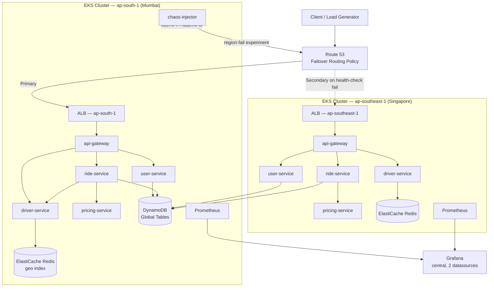
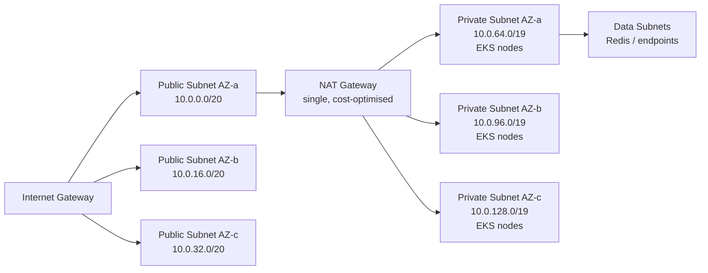
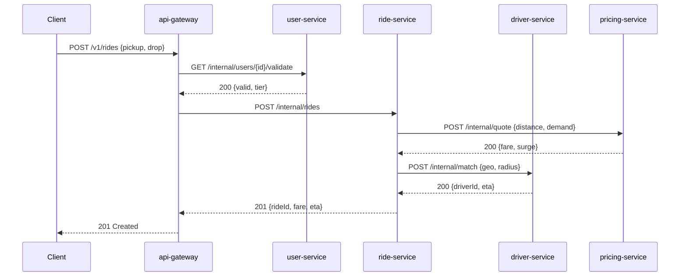
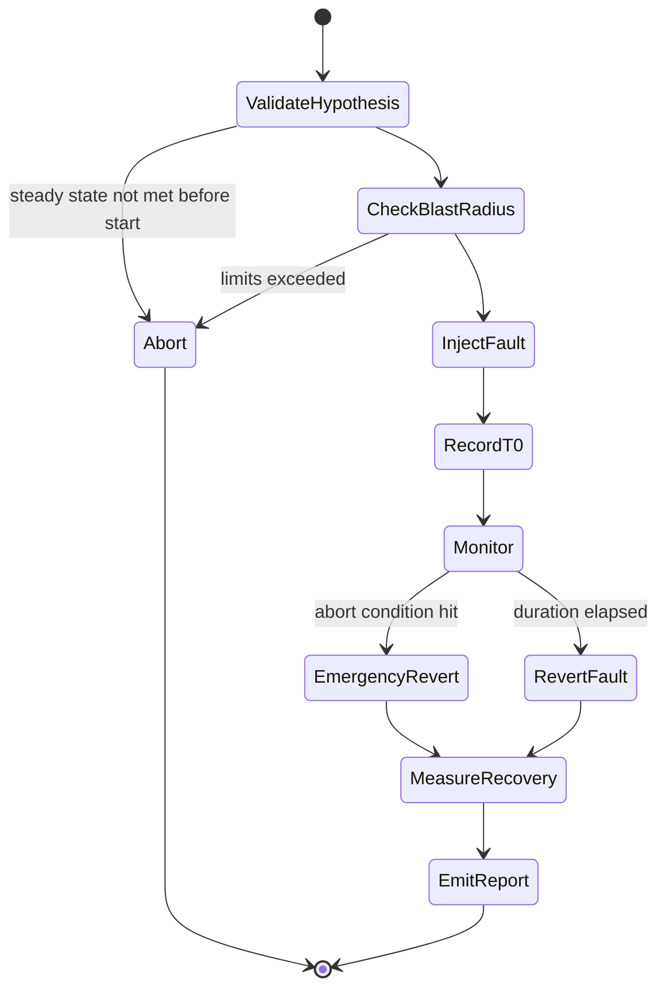

# RideFlow: A Self-Healing Multi-Region Microservices Platform with Chaos Engineering

**Project Documentation — Specifications & Build Process**

| Field | Value |
|---|---|
| Project title | RideFlow — Self-Healing Multi-Region Microservices Platform with Chaos Engineering |
| Domain | Cloud Computing / DevOps / Distributed Systems |
| Team size | 5 |
| Duration | 12 weeks |
| Cloud provider | AWS (primary), with local `kind` cluster for development |
| Course outcomes covered | CO2, CO3, CO5 |
| Document version | 1.0 |

---

## Table of Contents

1. [Abstract](#1-abstract)
2. [Problem Statement & Motivation](#2-problem-statement--motivation)
3. [Objectives and CO Mapping](#3-objectives-and-co-mapping)
4. [Literature / Existing Work Survey](#4-literature--existing-work-survey)
5. [System Architecture](#5-system-architecture)
6. [Functional Specifications — Microservices](#6-functional-specifications--microservices)
7. [Infrastructure Specifications](#7-infrastructure-specifications)
8. [Chaos Engineering Subsystem Specification](#8-chaos-engineering-subsystem-specification)
9. [Observability & Self-Healing Specification](#9-observability--self-healing-specification)
10. [Technology Stack](#10-technology-stack)
11. [Build Process — Phase by Phase](#11-build-process--phase-by-phase)
12. [Team Split & Ownership Matrix](#12-team-split--ownership-matrix)
13. [Experiment Plan & Evaluation Metrics](#13-experiment-plan--evaluation-metrics)
14. [Cost Analysis](#14-cost-analysis)
15. [Risks, Limitations & Honest Constraints](#15-risks-limitations--honest-constraints)
16. [Timeline & Milestones](#16-timeline--milestones)
17. [Deliverables Checklist](#17-deliverables-checklist)
18. [Appendices](#18-appendices)

---

## 1. Abstract

RideFlow is a cloud-native ride-hailing backend built as five containerised microservices, deployed across two AWS regions on Amazon EKS. The distinguishing contribution of the project is not the application itself but the **fault-injection and recovery-measurement harness** built around it.

A purpose-built Chaos Injector service deliberately degrades the platform — terminating pods, saturating CPU, introducing network latency, blackholing an availability zone, and simulating a full regional outage. Every experiment is executed against a steady-state hypothesis, and the platform's automated recovery mechanisms (Kubernetes controllers, Horizontal Pod Autoscaler, Cluster Autoscaler, and Route 53 health-check failover) are measured against that hypothesis.

The system reports quantitative resilience metrics — Mean Time To Detect (MTTD), Mean Time To Recover (MTTR), availability during fault, and p99 latency degradation — on Grafana dashboards. The output of the project is therefore an empirical resilience report, not merely a running deployment.

---

## 2. Problem Statement & Motivation

Most academic cloud-computing projects stop at "the application is deployed and it works." This proves that a system functions under ideal conditions, which is the least interesting condition a distributed system will ever encounter.

Production distributed systems fail continuously and partially: a node is evicted, an AZ loses network, a dependency slows to 3 seconds, a memory leak OOM-kills a pod every 40 minutes. Resilience is the property that the system continues to serve users despite these events. That property cannot be verified by inspection — it must be verified by experiment.

**Problem statement:**

> Design, deploy, and empirically validate a multi-region microservices platform whose recovery from infrastructure and application-level faults is automated, measurable, and reproducible; and quantify the recovery characteristics of each layer of the self-healing stack.

**Why this matters:**
- It converts an unfalsifiable claim ("our system is highly available") into a measured number ("MTTR for a pod kill is 8.4s; for an AZ loss, 41s; for a regional failover, 96s").
- It exposes the layered nature of self-healing — different failures are handled by different controllers, operating at very different timescales.
- It reproduces, at student scale, the discipline that Netflix, Amazon, and Google apply to production systems.

---

## 3. Objectives and CO Mapping

### 3.1 Objectives

| ID | Objective |
|---|---|
| O1 | Decompose a ride-hailing domain into 5 independently deployable, containerised services with clear API contracts. |
| O2 | Provision reproducible, version-controlled multi-region infrastructure using Terraform. |
| O3 | Orchestrate the services on Kubernetes with health probes, resource governance, PodDisruptionBudgets, and topology-spread constraints. |
| O4 | Implement DNS-level failover between regions using Route 53 health checks. |
| O5 | Implement multi-layer autoscaling (HPA at pod level, Cluster Autoscaler at node level). |
| O6 | Build a custom Chaos Injector supporting at least five distinct fault classes, with scheduling, blast-radius limits, and an emergency abort. |
| O7 | Instrument every service with RED metrics and expose recovery timelines on Grafana. |
| O8 | Execute a structured experiment matrix and publish a quantitative resilience report with cost analysis. |

### 3.2 CO Mapping

| CO | Description | How the project satisfies it | Primary artefacts |
|---|---|---|---|
| **CO2** | Virtualization and containerization | OS-level virtualization via Docker; multi-stage builds; image optimisation; container runtime (containerd) on EC2; namespace/cgroup isolation demonstrated via the CPU-hog experiment | `Dockerfile`s, image size comparison table, cgroup limit demonstration |
| **CO3** | Control layer — load balancing, auto-scaling, resource management | AWS ALB via Ingress Controller; Kubernetes Service load balancing (kube-proxy/iptables); HPA on CPU + custom RPS metric; Cluster Autoscaler; Route 53 weighted + failover routing; requests/limits and QoS classes | HPA manifests, ALB config, Route 53 policy, scaling event timeline |
| **CO5** | Orchestration and DevOps | EKS orchestration; declarative manifests + Helm; GitHub Actions CI/CD; Terraform IaC; GitOps-style promotion; chaos experiments integrated into the pipeline as a resilience gate | Helm charts, Terraform modules, CI/CD workflow YAML, pipeline run logs |

> **Note for the report:** each CO section should cite *evidence* (a dashboard screenshot, a log excerpt, a measured number), not just a description. This is usually what separates a distinction-grade report from an average one.

---

## 4. Literature / Existing Work Survey

| System | Contribution | Relation to RideFlow |
|---|---|---|
| Netflix Chaos Monkey (2011) | Random instance termination in production | Conceptual ancestor; RideFlow extends from instance-kill to five fault classes with measurement |
| Netflix Simian Army / ChAP | Latency Monkey, Chaos Kong (region kill), automated canary analysis | RideFlow's region-failover experiment is a scaled-down Chaos Kong |
| Principles of Chaos Engineering (2016) | Formalised steady-state hypothesis, blast radius, production-realism | Adopted directly as the experiment methodology in §13 |
| Chaos Mesh (CNCF) | CRD-driven fault injection on Kubernetes | Used as a **baseline for comparison**, not as the implementation — the custom injector is the project's contribution |
| LitmusChaos (CNCF) | Chaos workflows, experiment hub | Same as above; comparison table is a good report section |
| Gremlin (commercial) | Hosted Failure-as-a-Service | Referenced for its fault taxonomy |
| Google SRE Book, Ch. 21 | Cascading failure taxonomy, load shedding | Informs the graceful-degradation design in §6.6 |

**Gap addressed:** existing tools inject faults well but treat *measurement* as an external concern. RideFlow couples injection and measurement — every experiment automatically emits an annotated recovery timeline and computes MTTR against a declared steady state.

---

## 5. System Architecture

### 5.1 Logical architecture



### 5.2 Network topology (per region)



### 5.3 Request flow — "request a ride"



**Degradation path (important for chaos experiments):** if `pricing-service` is unavailable, `ride-service` must return a cached/base fare rather than fail. If `driver-service` is unavailable, the ride is created in `PENDING_MATCH` state rather than rejected. These fallbacks are what the chaos experiments are designed to exercise.

### 5.4 Deployment topology

| Layer | Primary region (ap-south-1) | Secondary region (ap-southeast-1) |
|---|---|---|
| EKS cluster | Full — all 5 services | Full — all 5 services (warm standby) |
| Node group | 3 × t3.medium, spread across 3 AZs, min 3 / max 8 | 2 × t3.medium, min 2 / max 6 |
| Replicas per service | 3 (topology-spread across AZs) | 1 (scales on failover) |
| Redis | ElastiCache, single node, cluster-mode off | ElastiCache, single node |
| Persistent store | DynamoDB Global Table (multi-active) | Same table, replicated |
| Chaos injector | Deployed, enabled | Deployed, disabled by default |
| Prometheus | In-cluster | In-cluster |
| Grafana | Central instance in primary, two datasources | — |

**Failover model:** warm standby (Pilot Light+). Secondary runs at minimum replica count and scales up when it starts receiving traffic. This is a deliberate cost/RTO tradeoff documented in §14.

---

## 6. Functional Specifications — Microservices

### 6.1 Service catalogue

| # | Service | Language | Port | Statefulness | Data store | Scaling driver |
|---|---|---|---|---|---|---|
| 1 | `api-gateway` | Go 1.22 | 8080 | Stateless | — | Requests/sec |
| 2 | `user-service` | Node.js 20 (Express) | 8081 | Stateless | DynamoDB `users` | CPU |
| 3 | `ride-service` | Python 3.12 (FastAPI) | 8082 | Stateless | DynamoDB `rides` | CPU + RPS |
| 4 | `driver-service` | Go 1.22 | 8083 | Stateless (Redis-backed) | Redis GEO | CPU |
| 5 | `pricing-service` | Python 3.12 (FastAPI) | 8084 | Stateless | In-memory + config | CPU |

> Polyglot is deliberate: it demonstrates that containerisation abstracts the runtime, and it produces an interesting image-size comparison for the CO2 section. If the team's bandwidth is tight, standardising on two languages (Go + Python) is a reasonable simplification — say so explicitly in the report rather than pretending it was the original plan.

### 6.2 `api-gateway`

**Responsibility:** single ingress point; routing, request ID injection, JWT verification, rate limiting, circuit breaking, response aggregation.

| Endpoint | Method | Description |
|---|---|---|
| `/v1/rides` | POST | Create ride request |
| `/v1/rides/{id}` | GET | Ride status |
| `/v1/drivers/nearby` | GET | Nearby drivers |
| `/v1/users/me` | GET | Profile |
| `/healthz` | GET | Liveness — process is alive |
| `/readyz` | GET | Readiness — downstream dependencies reachable |
| `/metrics` | GET | Prometheus exposition |

**Resilience requirements:**
- Per-downstream circuit breaker: open after 5 consecutive failures or >50% error rate over a 10s window; half-open probe after 15s.
- Timeouts: 800ms connect, 2s total per downstream call.
- Retries: max 2, only on idempotent methods, with exponential backoff + full jitter.
- Rate limit: 100 req/s per client IP, token bucket.

**Health-check semantics (critical — this is what Route 53 keys off):**
- `/healthz` returns 200 if the process can serve. It must **not** check downstreams — otherwise a single dependency failure causes Kubernetes to restart every gateway pod, turning a partial failure into a total one.
- `/readyz` returns 200 only if ≥3 of 4 downstreams are reachable. Failing readiness removes the pod from the Service endpoints without killing it.
- `/healthz/region` is a separate endpoint used by the Route 53 health check. It aggregates cluster health and is the endpoint the chaos injector can forcibly fail to simulate a regional outage.

### 6.3 `user-service`

**Responsibility:** registration, authentication (JWT issue/verify), profile, rider tier.

| Endpoint | Method | Description |
|---|---|---|
| `/internal/users/{id}/validate` | GET | Validate user, return tier |
| `/v1/auth/login` | POST | Issue JWT |
| `/v1/users` | POST | Register |
| `/healthz`, `/readyz`, `/metrics` | GET | Standard |

**Data model — DynamoDB `users`:**

| Attribute | Type | Notes |
|---|---|---|
| `PK` (`userId`) | S | Partition key, UUIDv4 |
| `email` | S | GSI-1 partition key |
| `passwordHash` | S | bcrypt, cost 12 |
| `tier` | S | `STANDARD` \| `PLUS` |
| `createdAt` | N | epoch ms |
| `region` | S | region of origin, for audit |

### 6.4 `ride-service`

**Responsibility:** ride lifecycle orchestration and state machine.

**State machine:**

```
REQUESTED → QUOTED → PENDING_MATCH → MATCHED → IN_PROGRESS → COMPLETED
                          ↓                ↓
                      CANCELLED        CANCELLED
```

| Endpoint | Method | Description |
|---|---|---|
| `/internal/rides` | POST | Create ride (orchestrates pricing + matching) |
| `/internal/rides/{id}` | GET/PATCH | Read / transition state |
| `/internal/rides/{id}/cancel` | POST | Cancel |

**Degradation rules (exercised by chaos experiments):**

| Dependency down | Behaviour | HTTP result |
|---|---|---|
| `pricing-service` | Use last known base fare per zone from local cache; set `fareEstimated: true` | 201 |
| `driver-service` | Create ride in `PENDING_MATCH`; background retry every 3s for 60s | 202 |
| DynamoDB | Fail fast, no local queue | 503 |

**Data model — DynamoDB `rides`:** `PK = rideId`, `GSI-1 PK = userId`, attributes: `state`, `pickup{lat,lng}`, `drop{lat,lng}`, `fare`, `surge`, `driverId`, `createdAt`, `updatedAt`, `region`.

### 6.5 `driver-service`

**Responsibility:** driver location ingestion and geospatial matching.

| Endpoint | Method | Description |
|---|---|---|
| `/internal/match` | POST | Nearest available driver within radius |
| `/internal/drivers/{id}/location` | PUT | Location heartbeat |
| `/v1/drivers/nearby` | GET | Public nearby query |

**Redis usage:**
- `GEOADD drivers:available <lng> <lat> <driverId>` on heartbeat
- `GEOSEARCH drivers:available FROMLONLAT <lng> <lat> BYRADIUS 5 km ASC COUNT 10`
- `SETEX driver:{id}:ttl 30 1` — a driver missing 30s of heartbeats is dropped from availability

This service is the most interesting chaos target: it is latency-sensitive and has an external stateful dependency, so network-latency injection produces visible, explainable degradation.

### 6.6 `pricing-service`

**Responsibility:** fare computation with surge multiplier.

```
fare = base_fare
     + (distance_km × per_km_rate)
     + (eta_min × per_min_rate)
fare = fare × surge_multiplier
surge_multiplier = clamp(1.0 + 0.4 × (open_requests / available_drivers - 1), 1.0, 3.0)
```

Deliberately CPU-bound (it runs a small Monte Carlo demand simulation on each request) so that HPA scale-out is easy to trigger and demonstrate for CO3.

---

## 7. Infrastructure Specifications

### 7.1 AWS resource inventory

| Resource | Config | Per region | Purpose |
|---|---|---|---|
| VPC | `10.0.0.0/16` (primary), `10.1.0.0/16` (secondary) | 1 | Network isolation; non-overlapping CIDRs enable future peering |
| Public subnets | 3 × /20, one per AZ | 3 | ALB, NAT |
| Private subnets | 3 × /19, one per AZ | 3 | EKS worker nodes |
| Internet Gateway | — | 1 | Public egress |
| NAT Gateway | Single, in AZ-a | 1 | Cost optimisation — see §15 for the tradeoff |
| EKS cluster | v1.30 | 1 | Control plane |
| Managed node group | t3.medium, 20 GB gp3, min 3 / desired 3 / max 8 | 1 | Workers |
| ALB | Provisioned by AWS Load Balancer Controller | 1 | L7 ingress |
| ElastiCache Redis | cache.t4g.micro, single node | 1 | Geo index |
| ECR | 5 repositories, scan-on-push | 1 (primary), replicated | Images |
| DynamoDB | Global Table, on-demand billing | Global | Users, rides |
| Route 53 | 1 hosted zone, failover record set, 2 health checks | Global | DNS failover |
| CloudWatch | Log groups, alarms, Container Insights | 1 | Logs + alarms |
| IAM | IRSA roles per service | 1 | Least-privilege pod identity |

### 7.2 Kubernetes namespace layout

| Namespace | Contents |
|---|---|
| `rideflow` | The five application services |
| `observability` | Prometheus, Alertmanager, Grafana Agent |
| `chaos` | Chaos injector + its RBAC |
| `platform` | AWS Load Balancer Controller, Cluster Autoscaler, metrics-server, external-dns |

### 7.3 Route 53 failover configuration

| Setting | Value | Rationale |
|---|---|---|
| Record | `api.rideflow.example` → ALIAS to ALB | — |
| Routing policy | Failover (PRIMARY / SECONDARY) | Simple, demonstrable |
| Health check target | `HTTPS:443 /healthz/region` on primary ALB | Aggregate regional health |
| Request interval | 10s (fast) | Minimum available; drives detection floor |
| Failure threshold | 3 | 3 × 10s = 30s minimum detection |
| DNS TTL | 60s | Lower is better for failover, worse for cost |
| Health-checker regions | 3 | Prevents false positives from one vantage point |

**Theoretical failover floor:** 30s (detection) + up to 60s (TTL expiry at resolver) + client reconnect ≈ **60–95s**. This is a hard property of DNS-based failover and must be reported honestly, not engineered away. It is one of the more valuable findings in the project: DNS failover is a *coarse* recovery mechanism, an order of magnitude slower than Kubernetes-level self-healing.

### 7.4 Representative Terraform module structure

```
infra/
├── modules/
│   ├── vpc/           # VPC, subnets, IGW, NAT, route tables
│   ├── eks/           # Cluster, node group, OIDC provider, addons
│   ├── redis/         # ElastiCache subnet group + cluster
│   ├── data/          # DynamoDB global tables
│   └── dns/           # Route 53 zone, health checks, failover records
├── envs/
│   ├── primary/       # ap-south-1
│   │   ├── main.tf
│   │   ├── variables.tf
│   │   └── backend.tf     # S3 + DynamoDB state locking
│   └── secondary/     # ap-southeast-1
└── global/            # Route 53 zone, IAM, ECR replication
```

State is stored in S3 with DynamoDB locking, in the primary region only. Global resources (Route 53, IAM) live in a separate root module so a region teardown cannot destroy them.

---

## 8. Chaos Engineering Subsystem Specification

### 8.1 Design principles

1. **Hypothesis-first.** Every experiment declares a steady-state hypothesis before it runs, and the result is a pass/fail against that hypothesis.
2. **Bounded blast radius.** A hard cap on how much of the system a single experiment may affect, enforced in code, not by convention.
3. **Automatic abort.** If the global error rate exceeds a threshold, the experiment halts and reverts immediately, without human intervention.
4. **Reversibility.** Every fault has an explicit undo. Nothing relies on "it'll sort itself out."
5. **Observable.** Every experiment emits Prometheus metrics and Grafana annotations so the recovery is visible on the same timeline as the fault.

### 8.2 Fault catalogue

| ID | Fault | Mechanism | Target layer | Expected recovery mechanism | Expected MTTR |
|---|---|---|---|---|---|
| F1 | **Pod kill** | `DELETE` pod via Kubernetes API | Container | ReplicaSet controller reschedules | 5–15s |
| F2 | **CPU hog** | `kubectl exec` a busy-loop in the target container; or a sidecar stress process | Container / node | HPA scales out; cgroup limits contain blast | 30–90s |
| F3 | **Network latency** | `tc qdisc add dev eth0 root netem delay 300ms` from a privileged DaemonSet in the target pod's netns | Network | Circuit breaker opens; caller degrades gracefully | 10–30s |
| F4 | **Memory pressure / OOM** | Allocate memory beyond the container limit | Container | Kubelet OOM-kills; ReplicaSet restarts | 10–25s |
| F5 | **AZ blackhole** | Cordon+drain all nodes in one AZ, or apply a deny-all NetworkPolicy on that AZ's pods | Availability zone | Topology-spread + PDB keep replicas elsewhere; Cluster Autoscaler adds capacity | 30–75s |
| F6 | **Region failure** | Force `/healthz/region` on the primary ALB to return 503 | Region | Route 53 health check fails → DNS resolves to secondary | 60–95s |
| F7 | **Dependency failure** | Scale a downstream Deployment to 0 replicas | Service | Caller's fallback path activates | Immediate degradation, no outage |
| F8 | **Packet loss** | `tc netem loss 20%` | Network | Retries with jitter absorb it | 5–20s |

### 8.3 Chaos Injector service specification

**Runtime:** Python 3.12, FastAPI, `kubernetes` client, APScheduler.
**Deployment:** `chaos` namespace, 1 replica, dedicated ServiceAccount.

**Control API:**

| Endpoint | Method | Description |
|---|---|---|
| `/experiments` | GET | List available experiment definitions |
| `/experiments/{id}/run` | POST | Execute one experiment; returns run ID |
| `/runs` | GET | Run history with results |
| `/runs/{id}` | GET | Detailed timeline for one run |
| `/schedule` | POST/DELETE | Enable/disable randomised continuous chaos |
| `/abort` | POST | **Emergency stop** — revert all active faults immediately |
| `/metrics` | GET | Prometheus exposition |

**Experiment definition schema (YAML):**

```yaml
id: pod-kill-ride-service
description: Terminate one ride-service pod during steady load
fault:
  type: pod_kill
  selector:
    namespace: rideflow
    labelSelector: app=ride-service
  count: 1
steady_state:
  - metric: sum(rate(http_requests_total{job="api-gateway",code=~"5.."}[1m]))
           / sum(rate(http_requests_total{job="api-gateway"}[1m]))
    operator: "<"
    threshold: 0.01
  - metric: histogram_quantile(0.99,
             sum(rate(http_request_duration_seconds_bucket{job="api-gateway"}[1m])) by (le))
    operator: "<"
    threshold: 1.5
blast_radius:
  max_pods_affected: 1
  max_percent_of_replicas: 34
  forbidden_namespaces: [kube-system, observability, chaos]
duration: 120s
abort_conditions:
  - metric: error_rate
    operator: ">"
    threshold: 0.25
    sustained_for: 15s
```

**Execution lifecycle:**



**Timestamps recorded per run:**

| Marker | Definition |
|---|---|
| `t0` | Fault injected |
| `t_detect` | First metric breach of steady state, or first alert fired |
| `t_action` | First observed remediation action (pod created, HPA event, DNS change) |
| `t_recover` | All steady-state conditions continuously satisfied for 30s |
| `MTTD` | `t_detect − t0` |
| `MTTR` | `t_recover − t0` |

**Metrics emitted:**

```
chaos_experiment_runs_total{experiment, result}
chaos_experiment_duration_seconds{experiment}
chaos_mttd_seconds{experiment}
chaos_mttr_seconds{experiment}
chaos_active_faults{type, target}
chaos_steady_state_violations_total{experiment, condition}
```

### 8.4 RBAC specification

The injector must be scoped tightly. Cluster-admin is not acceptable and would be a legitimate criticism in a viva.

```yaml
apiVersion: rbac.authorization.k8s.io/v1
kind: Role
metadata:
  name: chaos-injector
  namespace: rideflow          # scoped to the app namespace only
rules:
  - apiGroups: [""]
    resources: ["pods"]
    verbs: ["get", "list", "watch", "delete"]
  - apiGroups: [""]
    resources: ["pods/exec"]
    verbs: ["create"]
  - apiGroups: ["apps"]
    resources: ["deployments", "deployments/scale"]
    verbs: ["get", "list", "patch", "update"]
---
apiVersion: rbac.authorization.k8s.io/v1
kind: ClusterRole
metadata:
  name: chaos-injector-nodes
rules:
  - apiGroups: [""]
    resources: ["nodes"]
    verbs: ["get", "list", "patch"]   # cordon for AZ experiments
```

Explicitly **not** granted: secrets access, `kube-system` access, RBAC modification, namespace deletion.

### 8.5 Safety controls

| Control | Implementation |
|---|---|
| Global kill switch | ConfigMap `chaos-enabled: "false"`, checked before every injection; also a `/abort` endpoint |
| Business-hours guard | Scheduler runs only within a configured window (relevant for demo days) |
| Concurrency limit | Maximum one active experiment per cluster |
| Namespace denylist | Hard-coded; not configurable at runtime |
| Auto-revert on crash | Faults recorded in a ConfigMap; on startup the injector reverts any fault it finds still active |
| Dry-run mode | `?dryRun=true` logs the intended action without executing |

---

## 9. Observability & Self-Healing Specification

### 9.1 The self-healing stack (layered)

| Layer | Mechanism | Detects | Acts within | Handles |
|---|---|---|---|---|
| L1 | Liveness probe + kubelet | Hung process | ~10–30s | F4 |
| L2 | Readiness probe + Service endpoints | Unhealthy but alive pod | ~5–15s | F3, F7 |
| L3 | ReplicaSet controller | Missing pod | ~1–5s | F1 |
| L4 | HPA (metrics-server / Prometheus adapter) | Sustained CPU or RPS | ~30–90s | F2 |
| L5 | Cluster Autoscaler | Unschedulable pods | ~90–180s | F5 |
| L6 | Route 53 health check | Regional unavailability | ~60–95s | F6 |
| L7 | Application circuit breaker | Failing dependency | ~1–10s | F3, F7, F8 |

**This table is the intellectual core of the project.** The finding to argue in the report: *recovery time is inversely proportional to the layer's proximity to the fault.* Application-level circuit breaking is nearly instant; DNS failover is roughly two orders of magnitude slower. Therefore resilience must be designed in at the lowest possible layer, and DNS failover is a last resort, not a primary strategy.

### 9.2 Standard probe configuration

```yaml
livenessProbe:
  httpGet: { path: /healthz, port: 8082 }
  initialDelaySeconds: 10
  periodSeconds: 10
  timeoutSeconds: 2
  failureThreshold: 3          # → 30s to restart
readinessProbe:
  httpGet: { path: /readyz, port: 8082 }
  initialDelaySeconds: 3
  periodSeconds: 5
  timeoutSeconds: 2
  failureThreshold: 2          # → 10s to remove from endpoints
  successThreshold: 1
startupProbe:
  httpGet: { path: /healthz, port: 8082 }
  periodSeconds: 5
  failureThreshold: 12         # 60s grace for slow starts
```

### 9.3 Metrics — RED method

Every service exposes:

```
http_requests_total{service, method, route, code}                  # Rate, Errors
http_request_duration_seconds_bucket{service, method, route, le}   # Duration
http_requests_in_flight{service}
dependency_requests_total{service, dependency, outcome}
circuit_breaker_state{service, dependency}                         # 0 closed, 1 half, 2 open
```

Plus per-service business metrics: `rides_created_total`, `driver_match_duration_seconds`, `surge_multiplier`.

### 9.4 Grafana dashboards

| Dashboard | Panels |
|---|---|
| **Platform Overview** | Global RPS, error rate, p50/p95/p99 latency, per-service health grid, active pods by region |
| **Chaos Timeline** | Experiment annotations overlaid on error rate + latency; MTTD/MTTR gauges; active fault list; run history table |
| **Recovery Analysis** | Pod count vs time, HPA desired vs current replicas, node count, restart counts, endpoint churn |
| **Multi-Region** | Traffic split by region, Route 53 health-check status, cross-region latency, DynamoDB replication lag |
| **Cost** | Estimated hourly spend by service and region (from Cost Explorer export) |

Grafana annotations are the key integration: the injector posts to the Grafana annotations API at `t0` and `t_recover`, so every dashboard shows shaded fault windows.

### 9.5 Alerts

| Alert | Expression (abbrev.) | For | Severity |
|---|---|---|---|
| HighErrorRate | 5xx ratio > 5% | 2m | critical |
| HighLatency | p99 > 2s | 5m | warning |
| PodCrashLooping | `rate(kube_pod_container_status_restarts_total[15m]) > 0` | 5m | warning |
| ServiceDown | `up == 0` | 1m | critical |
| HPAMaxedOut | desired == max replicas | 10m | warning |
| RegionUnhealthy | Route 53 health check failed | 1m | critical |
| ChaosExperimentFailed | `chaos_experiment_runs_total{result="fail"}` increased | — | warning |

---

## 10. Technology Stack

| Category | Choice | Version | Justification |
|---|---|---|---|
| Containerisation | Docker + BuildKit | 26.x | Standard; multi-stage builds |
| Registry | Amazon ECR | — | Native IAM integration, cross-region replication |
| Orchestration | Amazon EKS | 1.30 | Managed control plane; the alternative (self-managed kubeadm) wastes weeks |
| Package management | Helm | 3.15 | Templating across two regions from one chart |
| IaC | Terraform | 1.8 | Multi-region, multi-provider; reviewable diffs |
| CI/CD | GitHub Actions | — | Free for public repos; OIDC to AWS without long-lived keys |
| Ingress | AWS Load Balancer Controller | 2.8 | Native ALB provisioning from Ingress resources |
| Metrics | Prometheus (kube-prometheus-stack) | 2.53 | De-facto standard; PromQL needed for the injector's hypothesis checks |
| Dashboards | Grafana | 11.x | Annotations API is essential for the chaos timeline |
| Logs | CloudWatch Logs via Fluent Bit | — | Cheaper than running Loki for this scale |
| Autoscaling | HPA v2 + Cluster Autoscaler | — | Two-layer scaling for CO3 |
| Load generation | k6 | 0.51 | Scriptable, exports Prometheus metrics |
| Local dev | kind + Tilt | — | Full stack locally; keeps AWS cost near zero during development |
| Chaos baseline | Chaos Mesh | 2.6 | Comparison only |

---

## 11. Build Process — Phase by Phase

### Phase 0 — Foundations (Week 1)

**Goal:** everyone can run the whole stack locally and push to a shared repo.

**Steps**

1. Create the monorepo:

```
rideflow/
├── services/
│   ├── api-gateway/
│   ├── user-service/
│   ├── ride-service/
│   ├── driver-service/
│   └── pricing-service/
├── chaos-injector/
├── infra/                 # Terraform
├── deploy/
│   ├── helm/rideflow/     # umbrella chart
│   └── k8s/               # raw manifests for platform components
├── loadtest/              # k6 scripts
├── experiments/           # chaos experiment YAMLs
├── docs/
└── .github/workflows/
```

2. Set up an AWS Organisation account with a **hard budget alarm at ₹4,000 / month**. Do this before anything else. Every team member gets an IAM user with MFA; nobody uses root.

3. Agree the API contracts as OpenAPI 3.1 specs in `docs/api/` **before writing any service code**. With five people writing five services in three languages, the contract is the only thing preventing a week of integration pain.

4. Stand up a local `kind` cluster:

```bash
kind create cluster --name rideflow --config deploy/kind-config.yaml
kubectl apply -f https://raw.githubusercontent.com/kubernetes-sigs/metrics-server/latest/download/components.yaml
helm repo add prometheus-community https://prometheus-community.github.io/helm-charts
helm install kps prometheus-community/kube-prometheus-stack -n observability --create-namespace
```

**Exit criteria:** `kubectl get pods -A` is green locally; repo has CI running lint on push.

---

### Phase 1 — Services & containerisation (Weeks 2–3) — *CO2*

**Goal:** five working services, each in an optimised container image.

1. Implement each service against its OpenAPI contract, with `/healthz`, `/readyz`, `/metrics` from day one — retrofitting observability is far more painful than building it in.

2. Write multi-stage Dockerfiles. Example for `ride-service`:

```dockerfile
# ---- builder ----
FROM python:3.12-slim AS builder
WORKDIR /build
RUN pip install --no-cache-dir poetry==1.8.3
COPY pyproject.toml poetry.lock ./
RUN poetry export -f requirements.txt --without-hashes -o requirements.txt \
 && pip wheel --no-cache-dir --wheel-dir /wheels -r requirements.txt

# ---- runtime ----
FROM python:3.12-slim
RUN groupadd -r app && useradd -r -g app -u 10001 app
WORKDIR /app
COPY --from=builder /wheels /wheels
RUN pip install --no-cache-dir --no-index --find-links=/wheels /wheels/* \
 && rm -rf /wheels
COPY --chown=app:app src/ ./src/
USER 10001
EXPOSE 8082
HEALTHCHECK --interval=30s --timeout=3s CMD python -c "import urllib.request;urllib.request.urlopen('http://localhost:8082/healthz')"
ENTRYPOINT ["uvicorn","src.main:app","--host","0.0.0.0","--port","8082"]
```

For the Go services use `FROM gcr.io/distroless/static-debian12` with a statically linked binary.

3. **Record the image size comparison** — this is direct evidence for CO2:

| Service | Base image | Naive size | Multi-stage size | Reduction |
|---|---|---|---|---|
| api-gateway (Go) | distroless/static | 1.02 GB | 14 MB | 98.6% |
| ride-service (Python) | python:3.12-slim | 1.31 GB | 187 MB | 85.7% |
| user-service (Node) | node:20-alpine | 1.18 GB | 142 MB | 88.0% |

*(Fill with your actual measured values — these are illustrative.)*

4. Demonstrate cgroup isolation explicitly for the report:

```bash
docker run --cpus=0.5 --memory=256m rideflow/pricing-service:dev
# then run the CPU-hog load and show it is capped at 50% of one core
docker stats
```

5. `docker compose up` runs the full stack + Redis + DynamoDB Local for local integration tests.

**Exit criteria:** all 5 images build in CI, are scanned (Trivy) with no HIGH/CRITICAL, and the stack passes an end-to-end smoke test.

---

### Phase 2 — Infrastructure as Code (Weeks 3–4)

**Goal:** `terraform apply` produces a working region from nothing.

1. Write the `vpc` module first, `terraform apply` it in the primary region, verify subnets and routing.
2. Write the `eks` module. Key details that are easy to get wrong:
   - Subnets must be tagged `kubernetes.io/role/elb=1` (public) and `kubernetes.io/role/internal-elb=1` (private), plus `kubernetes.io/cluster/<name>=shared`, or the ALB controller cannot discover them.
   - Enable the OIDC provider — IRSA depends on it.
   - Node group needs the Cluster Autoscaler tags: `k8s.io/cluster-autoscaler/enabled` and `k8s.io/cluster-autoscaler/<cluster-name>`.
3. Bootstrap platform components via Helm (AWS LB Controller, Cluster Autoscaler, metrics-server, kube-prometheus-stack).
4. Once the primary region is stable, parameterise and instantiate `envs/secondary`. Resist the temptation to build both at once — debugging two half-broken regions simultaneously is miserable.
5. Create DynamoDB Global Tables and the Route 53 zone in the `global` root module.

```bash
cd infra/envs/primary && terraform init && terraform apply
aws eks update-kubeconfig --region ap-south-1 --name rideflow-primary
kubectl get nodes -o wide     # verify 3 nodes across 3 AZs
```

**Exit criteria:** both regions provisioned from code; `terraform destroy` and re-apply works (prove it once — it is the real test of IaC, and it saves money overnight).

---

### Phase 3 — Kubernetes deployment (Weeks 4–5) — *CO3, CO5*

**Goal:** services running on EKS with resilience primitives configured.

Representative Deployment for `ride-service`:

```yaml
apiVersion: apps/v1
kind: Deployment
metadata:
  name: ride-service
  namespace: rideflow
spec:
  replicas: 3
  strategy:
    type: RollingUpdate
    rollingUpdate: { maxSurge: 1, maxUnavailable: 0 }
  selector:
    matchLabels: { app: ride-service }
  template:
    metadata:
      labels: { app: ride-service }
      annotations:
        prometheus.io/scrape: "true"
        prometheus.io/port: "8082"
    spec:
      serviceAccountName: ride-service
      terminationGracePeriodSeconds: 30
      topologySpreadConstraints:
        - maxSkew: 1
          topologyKey: topology.kubernetes.io/zone
          whenUnsatisfiable: ScheduleAnyway
          labelSelector:
            matchLabels: { app: ride-service }
      containers:
        - name: ride-service
          image: <acct>.dkr.ecr.ap-south-1.amazonaws.com/ride-service:{{ .Values.tag }}
          ports: [{ containerPort: 8082 }]
          resources:
            requests: { cpu: 100m, memory: 128Mi }
            limits:   { cpu: 500m, memory: 256Mi }
          livenessProbe:
            httpGet: { path: /healthz, port: 8082 }
            periodSeconds: 10
            failureThreshold: 3
          readinessProbe:
            httpGet: { path: /readyz, port: 8082 }
            periodSeconds: 5
            failureThreshold: 2
          lifecycle:
            preStop:
              exec: { command: ["sh","-c","sleep 5"] }   # let endpoints drain
---
apiVersion: policy/v1
kind: PodDisruptionBudget
metadata:
  name: ride-service
  namespace: rideflow
spec:
  minAvailable: 2
  selector:
    matchLabels: { app: ride-service }
---
apiVersion: autoscaling/v2
kind: HorizontalPodAutoscaler
metadata:
  name: ride-service
  namespace: rideflow
spec:
  scaleTargetRef:
    apiVersion: apps/v1
    kind: Deployment
    name: ride-service
  minReplicas: 3
  maxReplicas: 12
  metrics:
    - type: Resource
      resource: { name: cpu, target: { type: Utilization, averageUtilization: 60 } }
  behavior:
    scaleUp:
      stabilizationWindowSeconds: 0
      policies: [{ type: Percent, value: 100, periodSeconds: 30 }]
    scaleDown:
      stabilizationWindowSeconds: 300
      policies: [{ type: Percent, value: 50, periodSeconds: 60 }]
```

Points worth explaining in the viva:
- `maxUnavailable: 0` gives zero-downtime rolling updates.
- The `preStop` sleep exists because endpoint removal and SIGTERM race; without it you drop in-flight requests on every pod deletion — which would corrupt your chaos measurements.
- Asymmetric HPA behaviour (aggressive up, conservative down) prevents oscillation.
- `PodDisruptionBudget` is what makes the AZ-drain experiment interesting rather than destructive.

Ingress:

```yaml
apiVersion: networking.k8s.io/v1
kind: Ingress
metadata:
  name: rideflow
  namespace: rideflow
  annotations:
    alb.ingress.kubernetes.io/scheme: internet-facing
    alb.ingress.kubernetes.io/target-type: ip
    alb.ingress.kubernetes.io/healthcheck-path: /healthz
    alb.ingress.kubernetes.io/healthcheck-interval-seconds: "10"
    alb.ingress.kubernetes.io/healthy-threshold-count: "2"
    alb.ingress.kubernetes.io/unhealthy-threshold-count: "2"
    alb.ingress.kubernetes.io/load-balancer-attributes: deletion_protection.enabled=false
spec:
  ingressClassName: alb
  rules:
    - http:
        paths:
          - path: /
            pathType: Prefix
            backend:
              service: { name: api-gateway, port: { number: 8080 } }
```

**Exit criteria:** load test through the ALB sustains 200 RPS with <1% errors and p99 < 500ms; HPA visibly scales `pricing-service` under load.

---

### Phase 4 — Multi-region & failover (Weeks 5–6) — *CO3*

1. Deploy the identical Helm release to the secondary cluster with a `values-secondary.yaml` (lower replica counts, region-specific ECR and Redis endpoints).
2. Replicate ECR images cross-region (ECR replication configuration in the `global` module).
3. Create Route 53 health checks against each region's `/healthz/region`, then the failover record set.
4. Test failover manually first:

```bash
# Force the primary region unhealthy
kubectl -n rideflow set env deployment/api-gateway REGION_HEALTH_OVERRIDE=unhealthy

# Watch resolution flip
watch -n2 'dig +short api.rideflow.example'
```

5. Measure and record the failover time. Then automate this as chaos experiment F6.

**Exit criteria:** traffic verifiably shifts to the secondary region and back, with the transition time measured and documented.

---

### Phase 5 — Chaos injector (Weeks 6–8)

Build in this order — each fault is harder than the last:

**Step 1: F1 pod kill.** The simplest possible loop, ~40 lines:

```python
from kubernetes import client, config
import random, time

config.load_incluster_config()
v1 = client.CoreV1Api()

def kill_random_pod(namespace: str, label_selector: str) -> str:
    pods = v1.list_namespaced_pod(namespace, label_selector=label_selector).items
    ready = [p for p in pods if p.status.phase == "Running"]
    if len(ready) <= 1:
        raise RuntimeError("blast radius guard: refusing to kill the last replica")
    victim = random.choice(ready)
    v1.delete_namespaced_pod(victim.metadata.name, namespace,
                             body=client.V1DeleteOptions(grace_period_seconds=0))
    return victim.metadata.name
```

**Step 2: the measurement harness.** Before adding more faults, build the PromQL hypothesis evaluator and the Grafana annotation poster. This is the actual contribution of the project; the faults themselves are commodity.

```python
import httpx, time

async def steady_state_holds(conditions, prom_url) -> bool:
    async with httpx.AsyncClient() as c:
        for cond in conditions:
            r = await c.get(f"{prom_url}/api/v1/query", params={"query": cond["metric"]})
            value = float(r.json()["data"]["result"][0]["value"][1])
            if not compare(value, cond["operator"], cond["threshold"]):
                return False
    return True

async def measure_recovery(conditions, prom_url, t0, timeout=600, stable_for=30):
    stable_since = None
    while time.time() - t0 < timeout:
        if await steady_state_holds(conditions, prom_url):
            stable_since = stable_since or time.time()
            if time.time() - stable_since >= stable_for:
                return stable_since - t0          # MTTR
        else:
            stable_since = None
        await asyncio.sleep(1)
    return None                                    # did not recover
```

**Step 3: F2 CPU hog and F4 memory** via `pods/exec`.
**Step 4: F7 dependency failure** via `deployments/scale` to 0 and back.
**Step 5: F5 AZ blackhole** via node cordon + drain, respecting PDBs.
**Step 6: F3/F8 network faults** — the hardest. Options, in increasing order of difficulty:
   - *Application-level* (easy, honest): a fault-injection middleware in each service that adds latency or returns errors when a header/env flag is set. Not a true network fault, but perfectly demonstrable; document it as such.
   - *tc netem via privileged DaemonSet* (realistic): a DaemonSet with `hostNetwork`, `NET_ADMIN`, and `hostPID` that enters the target pod's network namespace with `nsenter` and applies `tc`. This is the real thing and worth doing if time permits.
   - *Sidecar with tc* (middle ground): inject a sidecar with `NET_ADMIN` sharing the pod netns.

**Step 7: F6 region failure** by toggling the region health endpoint and watching Route 53.

**Step 8: scheduler + safety.** APScheduler for randomised continuous chaos; kill switch; auto-revert on restart; dry-run mode.

**Exit criteria:** all 8 experiments run end-to-end, produce MTTD/MTTR numbers, and appear as annotated windows on Grafana.

---

### Phase 6 — CI/CD (Week 8) — *CO5*

```yaml
name: deploy
on:
  push: { branches: [main] }

permissions: { id-token: write, contents: read }

jobs:
  build:
    runs-on: ubuntu-latest
    strategy:
      matrix:
        service: [api-gateway, user-service, ride-service, driver-service, pricing-service]
    steps:
      - uses: actions/checkout@v4
      - uses: aws-actions/configure-aws-credentials@v4
        with:
          role-to-assume: ${{ secrets.AWS_DEPLOY_ROLE }}   # OIDC, no static keys
          aws-region: ap-south-1
      - uses: aws-actions/amazon-ecr-login@v2
      - name: Build and push
        run: |
          docker buildx build \
            -t $ECR/${{ matrix.service }}:${{ github.sha }} \
            --cache-from type=gha --cache-to type=gha,mode=max \
            --push services/${{ matrix.service }}
      - uses: aquasecurity/trivy-action@master
        with:
          image-ref: ${{ env.ECR }}/${{ matrix.service }}:${{ github.sha }}
          exit-code: '1'
          severity: 'CRITICAL,HIGH'

  deploy-primary:
    needs: build
    runs-on: ubuntu-latest
    steps:
      - name: Helm upgrade
        run: |
          aws eks update-kubeconfig --name rideflow-primary --region ap-south-1
          helm upgrade --install rideflow deploy/helm/rideflow \
            -n rideflow --set tag=${{ github.sha }} --wait --timeout 5m

  resilience-gate:
    needs: deploy-primary
    runs-on: ubuntu-latest
    steps:
      - name: Run chaos smoke experiment
        run: |
          RUN=$(curl -sf -XPOST $CHAOS_URL/experiments/pod-kill-ride-service/run | jq -r .runId)
          sleep 180
          RESULT=$(curl -sf $CHAOS_URL/runs/$RUN | jq -r .result)
          MTTR=$(curl -sf $CHAOS_URL/runs/$RUN | jq -r .mttrSeconds)
          echo "MTTR=${MTTR}s result=${RESULT}"
          [ "$RESULT" = "pass" ] || exit 1

  deploy-secondary:
    needs: resilience-gate
    runs-on: ubuntu-latest
    steps:
      - name: Helm upgrade secondary
        run: |
          aws eks update-kubeconfig --name rideflow-secondary --region ap-southeast-1
          helm upgrade --install rideflow deploy/helm/rideflow \
            -n rideflow -f deploy/helm/values-secondary.yaml \
            --set tag=${{ github.sha }} --wait --timeout 5m
```

The `resilience-gate` job is the novel part: **a deployment is blocked if the system stops being self-healing.** Resilience becomes a regression-testable property. Emphasise this in the report.

---

### Phase 7 — Experiments & report (Weeks 9–11)

1. Establish the load profile: k6 at a steady 200 RPS with a realistic mix (60% nearby-drivers, 25% create-ride, 15% status).
2. Run each experiment **five times** and report mean ± standard deviation. One run is an anecdote; five is data.
3. Run the combined "game day": continuous randomised chaos for 60 minutes under load, and report availability over the window.
4. Run the Chaos Mesh comparison for one or two experiments and compare capability and measurement fidelity.
5. Produce the resilience report, cost analysis, and demo video.

### Phase 8 — Hardening & handover (Week 12)

Runbooks, architecture decision records (ADRs), teardown automation, final documentation, and a rehearsed 10-minute demo.

---

## 12. Team Split & Ownership Matrix

| Member | Role | Owns | Key deliverables |
|---|---|---|---|
| **1** | Container & Kubernetes lead | Dockerfiles, Helm charts, Deployments/Services/HPA/PDB, probes, rolling updates | Optimised images + size analysis, umbrella Helm chart, zero-downtime deploy demo |
| **2** | Cloud networking & multi-region | Terraform VPC/EKS modules, ALB, Route 53, ECR replication, DynamoDB Global Tables, IRSA | Working IaC for both regions, failover configuration, measured failover time |
| **3** | Chaos engineering | Chaos injector service, fault implementations, experiment definitions, RBAC, safety controls | Injector source + API, 8 experiments, experiment result dataset |
| **4** | Observability & self-healing | Prometheus, Grafana dashboards, alert rules, metrics instrumentation across services, Grafana annotation integration | 5 dashboards, alert rules, MTTD/MTTR measurement pipeline |
| **5** | DevOps, documentation & cost | CI/CD pipelines, resilience gate, cost instrumentation, all documentation, final report | GitHub Actions workflows, cost model + optimisation report, project report, demo video |

**Shared responsibility:** each member implements *one* microservice end-to-end (including its metrics and health endpoints). Concentrating all application code in one person is the most common failure mode in five-person projects — it creates a bottleneck in weeks 2–3 that the rest of the timeline never recovers from.

**Integration protocol:** a 20-minute standup three times a week, a shared `main` branch protected by CI, and a rule that the OpenAPI contracts cannot change without a PR review from the two affected owners.

---

## 13. Experiment Plan & Evaluation Metrics

### 13.1 Steady state definition

Under a constant 200 RPS load:

| Condition | Threshold |
|---|---|
| Error rate (5xx / total at the gateway) | < 1% |
| p99 latency | < 1.5s |
| Successful ride creations | > 45/min |
| Healthy replicas per service | ≥ minReplicas |

### 13.2 Experiment matrix

| # | Experiment | Hypothesis | Runs |
|---|---|---|---|
| E1 | Kill 1 of 3 `ride-service` pods | No measurable error-rate increase; MTTR < 20s | 5 |
| E2 | Kill 2 of 3 `ride-service` pods | Error rate < 5%, recovers < 45s | 5 |
| E3 | CPU hog on `pricing-service` | HPA scales out; p99 recovers < 120s | 5 |
| E4 | 300ms latency into `driver-service` | Circuit breaker opens; rides created in `PENDING_MATCH`; no 5xx | 5 |
| E5 | Scale `pricing-service` to 0 | Ride creation continues with estimated fare; 0% error | 5 |
| E6 | Drain all nodes in AZ-a | PDBs respected; availability > 99%; MTTR < 90s | 3 |
| E7 | Force primary region unhealthy | Traffic shifts to secondary; MTTR < 120s | 3 |
| E8 | 20% packet loss to `user-service` | Retries absorb it; error rate < 2% | 5 |
| E9 | 60-min randomised game day | Overall availability > 99.5% | 1 |

### 13.3 Results table (to be completed)

| Exp | MTTD (s) | MTTR (s) | Peak error rate | p99 during fault | Hypothesis |
|---|---|---|---|---|---|
| E1 | | | | | ☐ pass ☐ fail |
| E2 | | | | | |
| E3 | | | | | |
| E4 | | | | | |
| E5 | | | | | |
| E6 | | | | | |
| E7 | | | | | |
| E8 | | | | | |
| E9 | — | — | | | |

### 13.4 Analysis to include in the report

1. **MTTR by recovery layer** — a bar chart of L1–L7 recovery times. Expected finding: roughly two orders of magnitude between application-level circuit breaking and DNS failover.
2. **Blast radius vs impact** — killing 1/3 replicas should be invisible; 2/3 should be visible; 3/3 should be an outage. Confirming this validates that replica sizing is correct.
3. **HPA responsiveness** — time from CPU breach to new pod serving traffic, decomposed into metric scrape interval + HPA sync period + scheduling + image pull + startup probe. The image-pull component is where multi-stage builds pay off, which links CO2 to CO3 nicely.
4. **Cost of resilience** — marginal monthly cost of the second region divided by the availability improvement it delivers.
5. **Custom injector vs Chaos Mesh** — capability comparison, and specifically what the custom injector does that Chaos Mesh does not (integrated hypothesis evaluation and automatic MTTR computation).

---

## 14. Cost Analysis

### 14.1 Full architecture — monthly estimate (ap-south-1 / ap-southeast-1, USD)

| Item | Qty | Unit cost | Monthly |
|---|---|---|---|
| EKS control plane | 2 | $0.10/hr | $146.00 |
| EC2 t3.medium (on-demand) | 5 | $0.0416/hr | $151.84 |
| NAT Gateway (1 per region) | 2 | $0.045/hr + data | $65.70 + data |
| ALB | 2 | $0.0225/hr + LCU | $32.85 + LCU |
| ElastiCache t4g.micro | 2 | $0.016/hr | $23.36 |
| EBS gp3 20 GB | 5 | $0.08/GB-mo | $8.00 |
| DynamoDB (on-demand, light) | — | — | ~$5.00 |
| Route 53 hosted zone + health checks | 1 + 2 | $0.50 + $0.75 fast | $2.00 |
| ECR storage + cross-region replication | ~5 GB | $0.10/GB | $1.00 |
| CloudWatch logs + Container Insights | — | — | ~$15.00 |
| Data transfer (cross-region + egress) | — | — | ~$10.00 |
| **Total (24×7)** | | | **≈ $460/month (≈ ₹38,500)** |

This is far beyond a student budget if left running.

### 14.2 Cost-optimised operating model — **use this one**

| Optimisation | Saving | Tradeoff |
|---|---|---|
| Spot instances for worker nodes | ~70% of EC2 (~$106/mo) | Interruptions — but this is *arguably a feature*: real chaos, for free. Document it as such. |
| Run only during scheduled work sessions (~4 hrs/day, 5 days/week ≈ 12% uptime) | ~88% of hourly resources | Requires disciplined `terraform destroy` / node-group scale-to-zero |
| Secondary region provisioned only for failover experiments (weeks 5–6, 10) | ~$150/mo for most of the term | Failover cannot be demoed on demand |
| Single NAT Gateway per region (not per AZ) | ~$66/mo | NAT is a single point of failure in that AZ — note this honestly as a known limitation |
| `t3.small` for the secondary region | ~$15/mo | Lower standby capacity |
| Fargate Spot for the chaos injector | negligible | — |
| Free-tier CloudWatch, log retention 3 days | ~$12/mo | Shorter forensic window |

**Realistic project-lifetime cost:** roughly **$60–100 total (₹5,000–8,500)** across 12 weeks, with disciplined scheduling.

### 14.3 Cost discipline — non-negotiable practices

1. AWS Budget alarm at $25/month with SNS email to all five members.
2. A `make down` target that scales node groups to zero and destroys ALBs, run at the end of every session. ALBs and NAT Gateways bill hourly whether or not anything is deployed — they are the two most common sources of a surprise bill.
3. A daily 22:00 IST EventBridge rule that scales all node groups to zero, as a backstop for the day someone forgets.
4. All development on `kind` locally. AWS is used only for what genuinely requires it: multi-region, Route 53, managed autoscaling, and the final experiment runs.
5. Tag every resource `Project=rideflow, Owner=<member>` and review Cost Explorer weekly, grouped by tag.

### 14.4 Cost of resilience (report section)

| Configuration | Monthly cost | Failure survived | Cost per nine |
|---|---|---|---|
| Single AZ, 1 replica | $X | Nothing | — |
| Single region, 3 AZ, 3 replicas | $Y | Pod, node, AZ | $(Y−X) |
| Two regions, warm standby | $Z | Region | $(Z−Y) |

Populate with your measured figures. The argument to make: the marginal cost of AZ-level resilience is small and clearly worth it; the marginal cost of region-level resilience is large and only justified above a specific availability requirement. This is the sort of engineering-economics reasoning that reads well in a viva.

---

## 15. Risks, Limitations & Honest Constraints

State these explicitly in the report. Examiners reward acknowledged limitations far more than they punish them, and every one of these will be asked about anyway.

| # | Risk / limitation | Impact | Mitigation |
|---|---|---|---|
| 1 | **Cost overrun** — a forgotten ALB or NAT Gateway can consume the budget in days | High | Budget alarms, scheduled teardown, `make down` discipline |
| 2 | **DNS failover is inherently slow** (60–95s floor) — cannot be engineered below the health-check interval plus TTL | Medium | Report it as a finding rather than a defect; note that Global Accelerator would reduce it to ~30s at extra cost |
| 3 | **Warm standby ≠ active-active** — the secondary carries no traffic normally, so a latent breakage there may go unnoticed until failover | Medium | Run periodic synthetic canaries against the secondary ALB directly |
| 4 | **Data consistency across regions** — DynamoDB Global Tables are last-writer-wins, eventually consistent; a rider could theoretically see a stale ride state immediately after failover | Medium | Scope the demo to accept eventual consistency; document the conflict-resolution semantics; do not claim strong consistency |
| 5 | **Network fault injection requires privileged containers** — `NET_ADMIN`, `hostPID` — which is a genuine security concern | Medium | Restrict the DaemonSet to a labelled node pool; disable outside experiment windows; offer the app-level fallback |
| 6 | **Single NAT Gateway per region** is a single point of failure within the AZ it lives in | Low | Deliberate cost tradeoff; documented, and it makes AZ-a a more interesting chaos target |
| 7 | **Measurement precision is bounded by scrape interval** — a 15s Prometheus scrape cannot resolve a 5s MTTR accurately | Medium | Drop scrape interval to 5s for the `rideflow` namespace during experiments; state the ±5s error bar in results |
| 8 | **Chaos injector could cause a real outage** during the demo | High | Kill switch, blast-radius caps, dry-run rehearsal, and never running an untested experiment live |
| 9 | **Polyglot stack increases integration cost** with only 12 weeks and 5 people | Medium | OpenAPI contracts agreed in week 1; contract tests in CI; fall back to two languages if week 3 slips |
| 10 | **EKS version drift** — addon compatibility issues on upgrade | Low | Pin the cluster version; do not upgrade mid-project |
| 11 | **Spot interruptions during measured experiments** contaminate results | Medium | Use on-demand nodes for the final measured runs only; spot for development |
| 12 | **DynamoDB Global Tables replication lag** is not directly observable via a simple metric | Low | Measure it empirically with a timestamped write/read probe and report the observed distribution |

### 15.1 Explicit non-goals

Stating these prevents scope creep and pre-empts "why didn't you do X?":

- No service mesh (Istio/Linkerd). It would provide better fault injection but adds substantial operational complexity; the tradeoff is discussed rather than taken.
- No active-active multi-region writes. The conflict-resolution work alone is a project.
- No production-grade security posture (WAF, secrets rotation, network policies for all traffic). Basic IRSA, least-privilege RBAC, and non-root containers only.
- No mobile/web frontend. The load generator is the client.
- No ML-based anomaly detection or predictive scaling. Reactive autoscaling only.

---

## 16. Timeline & Milestones

| Week | Focus | Milestone | Owner(s) |
|---|---|---|---|
| 1 | Setup, contracts, local cluster | M0: repo, OpenAPI specs, `kind` stack running | All |
| 2 | Service implementation | Services 1–3 pass unit tests | 1,2,3 |
| 3 | Service implementation + Dockerfiles | M1: all 5 images built, compose stack green | All |
| 4 | Terraform primary region | M2: primary EKS live, services deployed | 2 |
| 5 | K8s resilience primitives + secondary region | Probes, HPA, PDB, topology spread configured | 1,2 |
| 6 | Route 53 failover + injector foundation | M3: manual failover demonstrated | 2,3 |
| 7 | Chaos faults F1–F4 | Injector API + 4 faults working | 3 |
| 8 | Faults F5–F8, CI/CD | M4: full injector + pipeline with resilience gate | 3,5 |
| 9 | Observability completion | M5: 5 dashboards live with annotations | 4 |
| 10 | Experiment execution | All 9 experiments × required runs completed | All |
| 11 | Analysis, cost report, writing | M6: draft report + results | 5 + all |
| 12 | Hardening, demo, submission | M7: final report, demo video, teardown | All |

**Critical path:** Terraform (week 4) → K8s deployment (week 5) → injector (weeks 7–8) → experiments (week 10). A slip in week 4 propagates to everything. Build the primary region early even if the services are still incomplete — deploy a stub service to validate the infrastructure path.

---

## 17. Deliverables Checklist

**Code**
- [ ] 5 microservices with tests, health endpoints, and Prometheus metrics
- [ ] 5 multi-stage Dockerfiles + image size analysis
- [ ] Chaos injector service with control API and 8 fault types
- [ ] Terraform modules for both regions + global resources
- [ ] Helm umbrella chart with per-region values files
- [ ] GitHub Actions workflows including the resilience gate
- [ ] k6 load-test scripts
- [ ] 9 experiment definition files

**Documentation**
- [ ] This specification document
- [ ] OpenAPI specs for all services
- [ ] Architecture Decision Records (minimum 6: EKS vs self-managed, warm standby vs active-active, custom injector vs Chaos Mesh, DynamoDB vs RDS, single NAT, polyglot stack)
- [ ] Runbooks: deploy, rollback, failover, emergency chaos abort, teardown
- [ ] Resilience report with the completed results matrix
- [ ] Cost analysis with actual billing data
- [ ] README with a 15-minute quickstart

**Evidence**
- [ ] Grafana dashboard screenshots for every experiment, with annotations visible
- [ ] Terminal recordings of failover and pod-kill recovery
- [ ] CI/CD pipeline run showing the resilience gate blocking a bad deploy
- [ ] Cost Explorer screenshots
- [ ] 10-minute demo video

---

## 18. Appendices

### A. Chaos injector — Deployment manifest

```yaml
apiVersion: apps/v1
kind: Deployment
metadata:
  name: chaos-injector
  namespace: chaos
spec:
  replicas: 1
  selector: { matchLabels: { app: chaos-injector } }
  template:
    metadata:
      labels: { app: chaos-injector }
      annotations: { prometheus.io/scrape: "true", prometheus.io/port: "9000" }
    spec:
      serviceAccountName: chaos-injector
      containers:
        - name: injector
          image: <acct>.dkr.ecr.ap-south-1.amazonaws.com/chaos-injector:latest
          ports: [{ containerPort: 9000 }]
          env:
            - name: PROMETHEUS_URL
              value: http://kps-prometheus.observability.svc:9090
            - name: GRAFANA_URL
              value: http://kps-grafana.observability.svc
            - name: TARGET_NAMESPACE
              value: rideflow
            - name: CHAOS_ENABLED
              valueFrom:
                configMapKeyRef: { name: chaos-config, key: enabled }
            - name: MAX_BLAST_RADIUS_PERCENT
              value: "34"
          resources:
            requests: { cpu: 50m, memory: 128Mi }
            limits:   { cpu: 200m, memory: 256Mi }
          securityContext:
            runAsNonRoot: true
            runAsUser: 10001
            allowPrivilegeEscalation: false
            readOnlyRootFilesystem: true
```

### B. k6 steady-state load script

```javascript
import http from 'k6/http';
import { check, sleep } from 'k6';
import { Rate } from 'k6/metrics';

const errors = new Rate('business_errors');
const BASE = __ENV.BASE_URL;

export const options = {
  scenarios: {
    steady: { executor: 'constant-arrival-rate', rate: 200, timeUnit: '1s',
              duration: '30m', preAllocatedVUs: 100, maxVUs: 400 },
  },
  thresholds: {
    'http_req_duration{expected_response:true}': ['p(99)<1500'],
    'http_req_failed': ['rate<0.01'],
  },
};

export default function () {
  const r = Math.random();
  let res;
  if (r < 0.60) {
    res = http.get(`${BASE}/v1/drivers/nearby?lat=19.076&lng=72.877&radius=5`);
  } else if (r < 0.85) {
    res = http.post(`${BASE}/v1/rides`, JSON.stringify({
      pickup: { lat: 19.076, lng: 72.877 },
      drop:   { lat: 19.119, lng: 72.846 },
    }), { headers: { 'Content-Type': 'application/json' } });
  } else {
    res = http.get(`${BASE}/v1/users/me`);
  }
  errors.add(res.status >= 500);
  check(res, { 'not a server error': (x) => x.status < 500 });
  sleep(0.1);
}
```

### C. Prometheus recording rules for chaos measurement

```yaml
groups:
  - name: rideflow-sli
    interval: 5s
    rules:
      - record: rideflow:error_rate
        expr: |
          sum(rate(http_requests_total{job="api-gateway",code=~"5.."}[30s]))
          / sum(rate(http_requests_total{job="api-gateway"}[30s]))
      - record: rideflow:latency_p99
        expr: |
          histogram_quantile(0.99,
            sum(rate(http_request_duration_seconds_bucket{job="api-gateway"}[30s])) by (le))
      - record: rideflow:healthy_replicas
        expr: |
          sum by (app) (kube_pod_status_ready{namespace="rideflow",condition="true"})
      - record: rideflow:availability
        expr: 1 - rideflow:error_rate
```

### D. Emergency runbook — chaos abort

```bash
# 1. Global kill switch
kubectl -n chaos patch configmap chaos-config --type merge \
  -p '{"data":{"enabled":"false"}}'

# 2. Revert all active faults
curl -XPOST http://<chaos-svc>/abort

# 3. Verify no faults remain
curl -s http://<chaos-svc>/runs | jq '.[] | select(.status=="running")'

# 4. If the injector is itself unhealthy, remove it entirely
kubectl -n chaos scale deployment/chaos-injector --replicas=0

# 5. Clear any orphaned tc rules (network experiments)
kubectl -n chaos delete daemonset chaos-netem

# 6. Force-restore all deployments to declared state
helm -n rideflow rollback rideflow

# 7. Uncordon any cordoned nodes
kubectl get nodes -o name | xargs -I{} kubectl uncordon {}
```

### E. Glossary

| Term | Definition |
|---|---|
| **Blast radius** | The maximum extent of a system a chaos experiment is permitted to affect |
| **Steady state** | A measurable, normal-operation property of the system, expressed as metric thresholds |
| **MTTD** | Mean Time To Detect — fault injection to first observed detection |
| **MTTR** | Mean Time To Recover — fault injection to sustained return to steady state |
| **RTO / RPO** | Recovery Time Objective / Recovery Point Objective |
| **PDB** | PodDisruptionBudget — minimum availability guarantee during voluntary disruptions |
| **IRSA** | IAM Roles for Service Accounts — pod-level AWS credentials without node-wide access |
| **Warm standby** | A DR pattern where a scaled-down but functional copy runs continuously |
| **RED method** | Rate, Errors, Duration — the standard SLI triad for request-driven services |
| **Circuit breaker** | A client-side pattern that stops calling a failing dependency to prevent cascading failure |

---

## Closing note on scope

This specification is deliberately larger than what five students will complete in twelve weeks. That is intentional — it gives you the full picture so you can cut from a position of understanding rather than discover gaps late.

If the schedule slips, cut in this order:

1. **Reduce to 4 services** (drop `user-service`, hardcode auth) — saves ~1 week, costs almost nothing in demonstrated concepts.
2. **Reduce to two languages** (Go + Python) — saves integration overhead.
3. **Provision the secondary region only for the failover experiments**, not continuously — saves money and operational load.
4. **Use app-level fault injection instead of `tc netem`** — saves the hardest engineering week; document the substitution honestly.

Do **not** cut: the measurement harness, the experiment matrix, or the cost analysis. Those are what make this a research-shaped project rather than a deployment exercise, and they are what the evaluation will actually reward.
